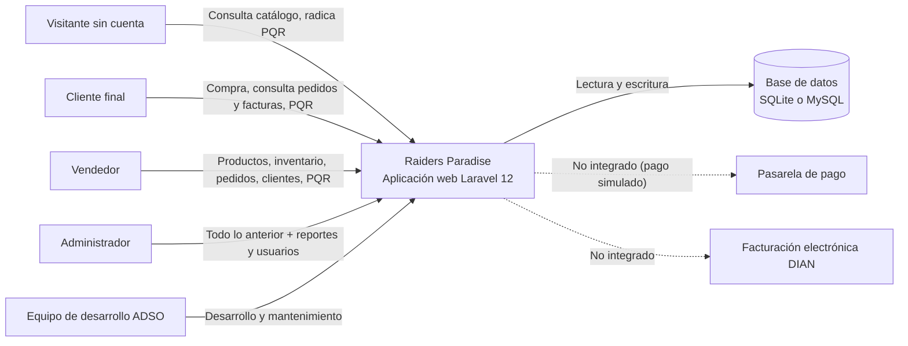
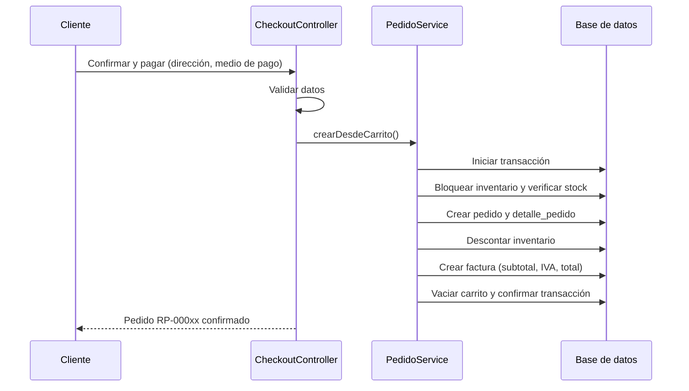

# PROJECT_CONTEXT.md — Raiders Paradise

**Versión:** 2.1 (octubre de 2026). Reemplaza la versión 1.0, que describía el repositorio cuando solo contenía migraciones.

## Tabla de contenido

1. [Propósito y problema de negocio](#1-propósito-y-problema-de-negocio)
2. [Alcance y límites](#2-alcance-y-límites)
3. [Stakeholders](#3-stakeholders)
4. [Usuarios, roles y casos de uso](#4-usuarios-roles-y-casos-de-uso)
5. [Sistemas externos e integraciones](#5-sistemas-externos-e-integraciones)
6. [Restricciones](#6-restricciones)
7. [Supuestos y dependencias](#7-supuestos-y-dependencias)
8. [Contexto organizacional](#8-contexto-organizacional)
9. [Contexto técnico](#9-contexto-técnico)
10. [Riesgos, deuda técnica y datos pendientes](#10-riesgos-deuda-técnica-y-datos-pendientes)
11. [Historial del documento](#11-historial-del-documento)

> **Criterio de lectura:** las etiquetas de estado distinguen lo que está construido y comprobado de lo que solo está previsto. **Implementado y probado** = existe en el código y lo cubren pruebas automáticas o recorridos en navegador. **Implementado** = existe en el código y se revisó manualmente. **Simulado** = funciona para pruebas, pero no se conecta con un sistema real. **No implementado** = fuera del alcance actual. **Por validar** = depende de información o entornos que aún no se han comprobado.

## 1. Propósito y problema de negocio

Raiders Paradise es una plataforma web para una microempresa colombiana que vende **accesorios de lujo para motociclistas**: cascos, guantes, chaquetas, impermeables, botas y accesorios (intercomunicadores, baúles, visores). Su propósito es vender en línea y, al mismo tiempo, organizar la operación interna de la tienda.

Necesidades que atiende:

- Mostrar el catálogo con precios, marcas, categorías y disponibilidad real.
- Permitir que los clientes compren en línea y consulten sus pedidos y facturas.
- Controlar el inventario con alertas de reposición.
- Gestionar pedidos, desde que se reciben hasta que se entregan o cancelan.
- Atender peticiones, quejas, reclamos y sugerencias (PQR) con trazabilidad.
- Dar al administrador **reportes gerenciales** para tomar decisiones: ventas, productos, categorías, clientes, pedidos, inventario y PQR.

Los beneficios esperados (información organizada, trazabilidad y mejor atención) son objetivos del proyecto. El sistema no se ha usado todavía con datos reales en producción.

El proyecto se desarrolla en el programa de formación **Análisis y Desarrollo de Software (ADSO) del SENA**.

## 2. Alcance y límites

### 2.1 Estado de los módulos

| Área | Evidencia en el repositorio | Estado |
|---|---|---|
| Roles y usuarios | Tablas `rol` y `usuario`; modelo `Usuario`; middleware `EnsureRol`; `Admin/UsuarioController` | **Implementado y probado** |
| Autenticación | `AuthController`: ingreso, registro y cierre de sesión; cuentas activas o inactivas | **Implementado y probado** |
| Clientes | Tabla `cliente` enlazada opcionalmente con `usuario`; vistas de cliente en el panel | **Implementado y probado** |
| Categorías, marcas, proveedores | `Admin/MaestroController` (CRUD genérico) | **Implementado y probado** |
| Productos | `Admin/ProductoController` con carga de imagen; protección de productos con ventas | **Implementado y probado** |
| Inventario | Entradas, salidas y ajustes; alertas de stock bajo y agotado | **Implementado y probado** |
| Catálogo público | Búsqueda, filtros por categoría, marca y precio; orden; ficha de producto | **Implementado y probado** |
| Carrito | Carrito persistente en base de datos, uno por cliente | **Implementado y probado** |
| Pedidos | Compra en transacción con bloqueo de inventario; estados; cancelación con devolución de stock | **Implementado y probado** |
| Facturas | Una factura por pedido, con subtotal, IVA 19 % y total; versión imprimible | **Implementado y probado** (documento de prueba, sin validez ante la DIAN) |
| Pagos | Selección de Nequi, PSE, tarjeta o contra entrega | **Simulado**: se registra el pago sin pasarela |
| PQR | Radicación pública o con cuenta; asignación de responsable; respuesta obligatoria para cerrar | **Implementado y probado** |
| Reportes | 7 reportes en pantalla, PDF imprimible y CSV para Excel; historial en tabla `reporte` | **Implementado y probado** |
| Dashboard | Indicadores del mes, gráficas, últimos pedidos, alertas | **Implementado y probado** |
| Interfaz web | Vistas Blade, CSS y JavaScript propios con los colores de marca; adaptable a móvil | **Implementado** (revisado con capturas en escritorio y móvil) |
| Base de datos MySQL | Script `database/sql/raidersparadise_mysql.sql` generado desde las migraciones; migraciones ejecutadas sobre MySQL (XAMPP) en el equipo del usuario | **Implementado**; falta correr las pruebas automáticas sobre MySQL |
| Documentación del código | PHPDoc, JSDoc y comentarios de vistas en todo el código; sitio HTML en `docs/api`; generador `tools/generar-documentacion.php` | **Implementado** |
| API REST | — | **No implementado** |
| Pasarela de pago real | — | **No implementado** |
| Facturación electrónica DIAN | — | **No implementado** |
| Recuperación de contraseña por correo | Tabla `password_reset_tokens` existe; flujo no construido | **No implementado** |
| Despliegue en producción | — | **No implementado** |

### 2.2 Límites actuales

- El pago es simulado: el sistema registra el medio de pago y marca la factura como pagada, pendiente (contra entrega) o anulada, pero no mueve dinero.
- La factura es un comprobante interno de prueba.
- No se envían correos, SMS ni notificaciones.
- No hay integración con transportadoras; el seguimiento se basa en el estado que actualiza el personal.
- El sistema funciona en entorno local de desarrollo (servidor `artisan serve` o Docker).

### 2.3 Diagrama de contexto



## 3. Stakeholders

No se han documentado nombres propios ni asignaciones formales. Los siguientes son roles del proyecto.

| Stakeholder | Interés principal | Responsabilidad |
|---|---|---|
| Propietario de la microempresa (**previsto**) | Vender más y controlar la operación | Validar reglas comerciales, precios y aceptar entregas |
| Clientes finales | Comprar equipo original con información clara y seguimiento | Registrar datos correctos y usar los canales habilitados |
| Administrador del sistema | Controlar catálogo, usuarios y resultados del negocio | Gestionar usuarios y analizar reportes |
| Vendedor / personal de bodega | Despachar pedidos y mantener el inventario al día | Actualizar estados, existencias y atender PQR |
| Equipo de desarrollo (aprendices ADSO) | Construir, probar y documentar el sistema | Implementar, revisar cambios y mantener el repositorio |
| Instructores del SENA | Evaluar el proceso formativo | Orientar y evaluar entregables |

## 4. Usuarios, roles y casos de uso

### 4.1 Roles

| Rol | Descripción | Usuario de prueba |
|---|---|---|
| Administrador | Acceso total, incluidos reportes y gestión de usuarios | `admin@raidersparadise.co` |
| Vendedor | Catálogo, inventario, pedidos, clientes y PQR; sin reportes ni usuarios | `ventas@raidersparadise.co` |
| Cliente | Tienda, carrito, compras, pedidos, facturas y PQR | `juan.perez@correo.co`, `maria.torres@correo.co`, `santiago.lopez@correo.co` |
| Visitante (sin cuenta) | Catálogo y radicación de PQR | — |

Contraseña de los usuarios de prueba: `Raiders2026*`.

### 4.2 Matriz de permisos

| Funcionalidad | Visitante | Cliente | Vendedor | Administrador |
|---|---|---|---|---|
| Ver catálogo y productos | Sí | Sí | Sí | Sí |
| Radicar PQR | Sí | Sí | — | — |
| Carrito, compra, mis pedidos, facturas propias | No | Sí | No | No |
| Panel: dashboard, productos, inventario, pedidos, clientes, PQR, catálogos | No | No | Sí | Sí |
| Ver cualquier factura | No | Solo las propias | Sí | Sí |
| Reportes | No | No | No | Sí |
| Usuarios y roles | No | No | No | Sí |

El acceso se controla con el middleware `rol:` en `routes/web.php`; además, los controladores verifican que un cliente solo vea sus propios pedidos, facturas y carrito. Las pruebas automáticas comprueban estas reglas.

### 4.3 Casos de uso

| Actor | Caso de uso | Estado |
|---|---|---|
| Visitante / cliente | Consultar y filtrar el catálogo | Implementado y probado |
| Visitante | Registrarse como cliente | Implementado y probado |
| Cliente | Gestionar el carrito | Implementado y probado |
| Cliente | Comprar (checkout) y recibir factura | Implementado y probado (pago simulado) |
| Cliente | Consultar pedidos, seguimiento y facturas | Implementado y probado |
| Visitante / cliente | Radicar una PQR y consultar su respuesta | Implementado y probado |
| Cliente | Actualizar sus datos y contraseña | Implementado |
| Vendedor / administrador | Gestionar productos, categorías, marcas y proveedores | Implementado y probado |
| Vendedor / administrador | Registrar movimientos de inventario | Implementado y probado |
| Vendedor / administrador | Cambiar el estado de pedidos y cancelarlos | Implementado y probado |
| Vendedor / administrador | Atender PQR | Implementado y probado |
| Administrador | Generar reportes en pantalla, PDF y Excel | Implementado y probado |
| Administrador | Gestionar usuarios y roles | Implementado y probado |

### 4.4 Reglas de negocio implementadas

- Los precios incluyen IVA del 19 %; la factura lo desglosa (subtotal = total / 1,19).
- Al comprar se usa el precio vigente del producto, no el guardado en el carrito.
- No se puede comprar más unidades de las disponibles ni productos inactivos o agotados.
- La compra, el descuento de inventario y la factura se registran en una sola transacción.
- Estados del pedido: pendiente → programado → en camino (`en_curso`) → entregado, o cancelado.
- Un pedido cancelado devuelve las unidades al inventario, anula la factura y no puede reactivarse.
- Un pago contra entrega queda «pendiente» y pasa a «pagada» al marcar el pedido como entregado.
- Un producto con ventas no se borra: se marca como inactivo. Una categoría, marca o proveedor con productos no se puede borrar.
- Una PQR solo se puede cerrar o rechazar con una respuesta escrita; al asignar un responsable pasa a «asignada».
- Los usuarios se desactivan en lugar de borrarse; un administrador no puede desactivarse ni cambiar su propio rol.
- Cada reporte generado queda registrado con usuario, tipo, formato, periodo y fecha.

## 5. Sistemas externos e integraciones

### 5.1 Componentes utilizados

| Sistema o herramienta | Uso |
|---|---|
| SQLite | Base de datos por defecto (`database/database.sqlite`); también se usa en las pruebas automáticas |
| MySQL 8 / MariaDB | Base de datos alternativa (XAMPP, Laragon o Docker); script en `database/sql/` |
| phpMyAdmin | Administración de MySQL en desarrollo (Docker en el puerto `8881` o XAMPP/Laragon) |
| Docker / Docker Compose | Entorno opcional con aplicación, MySQL y phpMyAdmin |
| Composer | Dependencias PHP |
| Laravel Pint | Verificación y corrección del estilo PSR-12 |
| Git y GitHub | Control de versiones; el proyecto se carga en un repositorio nuevo (instrucciones en la sección 11 del README) |
| Google Fonts | Tipografías Barlow y Barlow Condensed (si no hay internet se usan fuentes del sistema) |

### 5.2 Integraciones no implementadas

- Pasarela de pagos (Nequi, PSE, tarjetas): **simulada**.
- Facturación electrónica ante la DIAN.
- Correo, SMS o notificaciones (`MAIL_MAILER=log`).
- Transportadoras o seguimiento de envíos.
- Autenticación externa (Google, Facebook) y API REST.
- Analítica o publicidad.

## 6. Restricciones

### 6.1 Técnicas

- **Stack:** PHP `^8.2`, Laravel `^12.0`. El `Dockerfile` usa `php:8.3-cli`.
- **Frontend sin compilación:** las vistas usan `public/css/raiders.css` y `public/js/raiders.js` directamente. Vite, Tailwind y Axios siguen declarados en `package.json` pero no son necesarios para ejecutar el proyecto.
- **Base de datos:** las consultas usan SQL compatible con SQLite y MySQL 8 (`ONLY_FULL_GROUP_BY`). Las pruebas automáticas corren en SQLite.
- **Convención de nombres:** tablas y columnas en español con claves primarias personalizadas (`id_usuario`, `id_producto`, …), declaradas en cada modelo.
- **Estilo de código:** PSR-12 verificado con Laravel Pint; documentación con PHPDoc, JSDoc y comentarios de vistas.
- **Servidor de desarrollo:** `artisan serve` no es una configuración de producción.
- **Zona horaria y región:** `America/Bogota`, idioma `es`, moneda COP.

### 6.2 Por confirmar

- Presupuesto, fechas de entrega e infraestructura de producción.
- Integrantes del equipo y distribución formal de tareas.
- Navegadores y dispositivos soportados oficialmente (la interfaz se revisó en escritorio y en un ancho móvil de 390 px).
- Política de copias de seguridad y recuperación.

### 6.3 Seguridad y marco normativo

Controles implementados: contraseñas cifradas con bcrypt, regeneración de sesión al ingresar, protección CSRF en todos los formularios, límite de intentos en ingreso, registro y PQR, autorización por rol, verificación de propiedad de pedidos, facturas y carrito, validación de datos en todos los formularios y transacciones con bloqueo de inventario.

Los formularios de registro y PQR solicitan autorización de tratamiento de datos personales (Ley 1581 de 2012). Esta mención no certifica cumplimiento normativo: antes de operar con datos reales deben revisarse la política de tratamiento de datos, los requisitos de comercio electrónico y la facturación electrónica. Esto no constituye asesoría jurídica.

Las credenciales de `docker-compose.yml` y de los usuarios de prueba son **solo para desarrollo** y no deben usarse en producción.

## 7. Supuestos y dependencias

### 7.1 Dependencias técnicas

- PHP 8.2+ con las extensiones `pdo_sqlite` o `pdo_mysql`, `mbstring` y `fileinfo`.
- Composer 2 para instalar `vendor/` (no se incluye en el repositorio).
- Opcional: MySQL 8 o MariaDB 10.4+, Docker, VS Code con las extensiones recomendadas en `.vscode/extensions.json`.
- Archivo `.env` local coherente con la base de datos elegida (`.env.example` sirve como plantilla).

### 7.2 Supuestos

- Los precios del catálogo de demostración son referenciales; el negocio debe cargar sus precios reales.
- Las imágenes de productos de demostración son ilustraciones genéricas; deben reemplazarse por fotografías propias o autorizadas.
- Los clientes adicionales, pedidos y PQR de los datos de prueba son ficticios.

### 7.3 Por validar

- Ejecución de `php artisan test` con la conexión MySQL del equipo.
- Reglas comerciales definitivas: costo de envío, tallas, cambios y garantías.

## 8. Contexto organizacional

Raiders Paradise es un proyecto del programa ADSO del SENA. No se han documentado los integrantes, sus roles ni los instructores responsables.

**Flujo de trabajo con Git:** ramas `main` (estable) ← `develop` ← `feat/…` y `fix/…`, con commits con prefijos como `feat:` y Pull Requests hacia `develop`. La versión 2.1 completa (backend, frontend, base de datos, reportes, pruebas y documentación) se carga como primer commit de un repositorio nuevo.

No hay evidencia de una metodología formal (Scrum, Kanban) ni de herramientas de gestión de tareas; deben documentarse cuando el equipo las defina.

## 9. Contexto técnico

### 9.1 Tecnologías

| Componente | Tecnología | Uso |
|---|---|---|
| Lenguaje | PHP 8.2+ (8.3 en Docker) | Backend |
| Framework | Laravel 12 | Rutas, controladores, Eloquent, validación, sesiones, migraciones |
| Vistas | Blade | Plantillas HTML renderizadas en el servidor |
| Estilos | CSS propio (`public/css/raiders.css`) | Diseño con colores de marca y versión móvil |
| JavaScript | JavaScript propio sin librerías (`public/js/raiders.js`) | Menús, confirmaciones y gráficas SVG (línea, barras, dona) |
| Base de datos | SQLite (por defecto), MySQL 8 / MariaDB | Persistencia |
| Pruebas | PHPUnit 11 | 23 pruebas de funcionalidad y unitarias |
| Calidad | Laravel Pint (preset PSR-12), `.editorconfig` | Formato de código |
| Documentación | PHPDoc, JSDoc, `tools/generar-documentacion.php`, `phpdoc.dist.xml` (phpDocumentor opcional) | Documentación del código fuente en `docs/api` |
| Contenedores | Docker, Docker Compose, phpMyAdmin | Entorno opcional |

### 9.2 Arquitectura

Aplicación monolítica Laravel con capas:

```
Navegador
   │  petición HTTP
   ▼
routes/web.php  ──►  Middleware (auth, rol:..., throttle, CSRF)
   ▼
Controladores (app/Http/Controllers y Admin/)   ← validan datos y autorizan
   ▼
Servicios (app/Services)                         ← lógica de negocio con transacciones
   ▼
Modelos Eloquent (app/Models)                    ← relaciones y reglas de datos
   ▼
Base de datos (SQLite / MySQL)
   ▲
Vistas Blade (resources/views) + public/css + public/js   ← respuesta HTML
```

Las operaciones de negocio con varios pasos (compra, cambios de estado y reportes) están en `PedidoService` y `ReporteService`; las operaciones simples (CRUD) se resuelven en los controladores. No se usa una capa `Repository`.

### 9.3 Modelo de datos

22 tablas: 15 del negocio y 7 internas de Laravel (`sessions`, `cache`, `cache_locks`, `jobs`, `job_batches`, `failed_jobs`, `password_reset_tokens`), más la tabla de control `migrations`. El diccionario de datos completo (tipos, nulos, índices y llaves foráneas) está en `docs/api/base-de-datos.html`.

| Tabla | Relaciones principales |
|---|---|
| `rol` | 1 a muchos con `usuario` |
| `usuario` | Pertenece a `rol`; puede tener un `cliente`; genera `reporte`; atiende `pqr` |
| `cliente` | Enlace opcional y único con `usuario`; tiene `carrito`, `pedido` y `pqr` |
| `categoria`, `marca`, `proveedor` | 1 a muchos con `producto` |
| `producto` | Tiene un `inventario`; aparece en `detalle_carrito` y `detalle_pedido` |
| `inventario` | Uno por producto (`id_producto` único) |
| `carrito` → `detalle_carrito` | Un carrito por cliente; un ítem por producto |
| `pedido` → `detalle_pedido` | Detalle con borrado restringido hacia `producto` (protege el historial) |
| `factura` | Una por pedido; número `FE-000001` |
| `pqr` | Pertenece a `cliente`; responsable opcional (`usuario`) |
| `reporte` | Historial de reportes generados por un usuario |

### 9.4 Flujo de compra



### 9.5 Calidad, pruebas y documentación

- **23 pruebas automáticas, 171 verificaciones, todas aprobadas** (`tests/Feature/TiendaTest.php`, `tests/Feature/AdminTest.php`, `tests/Unit/FormatoTest.php`).
- Recorrido completo en navegador (Playwright) con los tres roles: compra hasta la factura, permisos 403, los 7 reportes, descarga CSV y vista móvil sin desbordamiento horizontal, sin errores de JavaScript ni del servidor.
- **Estilo PSR-12** verificado con Laravel Pint (`vendor/bin/pint --test --preset=psr12 app database routes tests tools`): resultado `passed`.
- **Documentación del código fuente:**
  - Todos los archivos PHP llevan un encabezado PHPDoc (`@package`, `@author`, `@version`, `@since`, `@license`).
  - Cada clase, constante, propiedad y método está documentado con `@param`, `@return`, `@throws`, `@var`, `@property` y `@see`.
  - El JavaScript usa JSDoc; cada vista Blade inicia con un comentario de propósito, controlador y variables; el CSS tiene un índice de secciones.
  - El sitio HTML `docs/api` (41 clases, 136 métodos, 53 rutas, 15 tablas y 47 vistas) se regenera con `php tools/generar-documentacion.php`.
  - `docs/README.md` trae la guía y una plantilla para archivos nuevos.
- El script MySQL se verificó cargando sus datos en una base nueva: sin violaciones de llaves foráneas, con sumas de ventas idénticas y con inicio de sesión correcto para los 5 usuarios.
- `CORRECCIONES.md` documenta los 17 errores corregidos del proyecto original.

### 9.6 Deuda técnica

1. Validación de formularios dentro de los controladores; podría migrarse a clases `FormRequest`.
2. No hay políticas (`Policy`) de Laravel; la autorización usa middleware y verificaciones en controladores.
3. `package.json`, `vite.config.js` y `resources/css|js` quedaron de la plantilla y no se usan.
4. Las imágenes subidas se guardan en `public/uploads/productos` (no en `storage`) para evitar `storage:link`; en producción conviene un disco de almacenamiento dedicado.
5. Sin recuperación de contraseña por correo.
6. Pruebas automáticas solo en SQLite.
7. Los métodos de prueba no tienen PHPDoc individual: su nombre describe la regla verificada.

## 10. Riesgos, deuda técnica y datos pendientes

### 10.1 Riesgos

| Riesgo | Impacto | Mitigación |
|---|---|---|
| Diferencias SQLite/MySQL no detectadas | Errores al usar MySQL | Correr `php artisan test` con la conexión MySQL |
| Bases creadas con las migraciones antiguas | Fallas al migrar («Table already exists») | `php artisan db:wipe` + `migrate --seed`, o reimportar el script |
| Confundir pago y factura simulados con reales | Expectativas incorrectas | Mensajes visibles en checkout y factura; integrar pasarela y DIAN antes de operar |
| Credenciales de desarrollo en producción | Acceso no autorizado | Cambiar contraseñas y secretos; desactivar usuarios de prueba |
| Datos personales sin política formal | Incumplimiento normativo | Definir política de tratamiento, retención y respaldo |
| Documentación desactualizada tras cambios | Información incorrecta para el equipo | Actualizar el PHPDoc con cada cambio y regenerar `docs/api` antes de cada entrega |
| Cambios del equipo sin integrar | Conflictos en Git | Subir la rama y revisar con Pull Request hacia `develop` |

### 10.2 Pendientes

- [x] Corregir migraciones y ejecutar migraciones con datos de prueba en entorno limpio.
- [x] Autenticación con roles y matriz de permisos.
- [x] Controladores, rutas, vistas y servicios de los módulos.
- [x] Reportes gerenciales para el administrador.
- [x] 5 usuarios de prueba y datos de demostración.
- [x] Pruebas automáticas.
- [x] Script SQL para MySQL y consultas de validación.
- [x] Base de datos creada en MySQL (XAMPP) en el equipo de desarrollo.
- [x] Documentación del código fuente (PHPDoc, JSDoc, vistas, CSS) y sitio HTML `docs/api`.
- [x] Estilo PSR-12 verificado con Laravel Pint.
- [ ] Correr las pruebas automáticas sobre MySQL.
- [ ] Cargar la versión 2.1 en el repositorio nuevo y crear las ramas `main` y `develop`.
- [ ] Definir integrantes, responsables y metodología del equipo (y poner los autores en los encabezados `@author`).
- [ ] Reemplazar precios e imágenes de demostración por los reales.
- [ ] Integrar pasarela de pago y facturación electrónica si el sistema se usará comercialmente.
- [ ] Recuperación de contraseña por correo.
- [ ] Definir entorno de despliegue, dominio, copias de seguridad y monitoreo.

## 11. Historial del documento

| Versión | Fecha | Cambios |
|---|---|---|
| 1.0 | — | Análisis inicial del repositorio con migraciones y un modelo |
| 2.0 | Octubre de 2026 | Integración de backend y frontend: autenticación con roles, tienda, carrito, checkout, facturas, PQR, panel administrativo, 7 reportes, datos de prueba, script MySQL, 23 pruebas automáticas y corrección de 17 errores |
| 2.1 | Octubre de 2026 | Documentación del código fuente (PHPDoc, JSDoc, vistas y CSS), sitio `docs/api` con su generador, estilo PSR-12 verificado y ajustes de instalación (`db:wipe`) |
